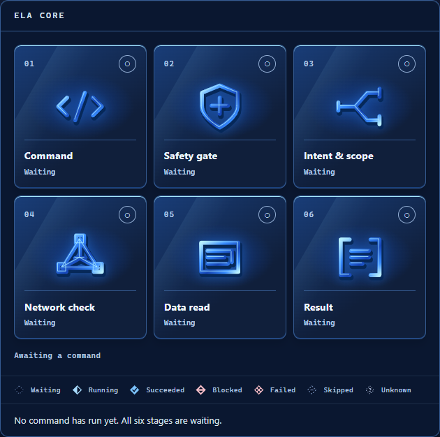

# Sapphire workspace — browser evidence

Captured from the actual production build in Chrome, 19 November 2026.

## Review the result

| State | Screenshot | Data source |
| --- | --- | --- |
| Desktop waiting | [Full page](desktop-waiting.png), [Core detail](desktop-core.png) | No command, all six stages waiting |
| Successful Diana query | [Live result](live-diana-success.png) | **Real Diana endpoint**, chain 9800; exact response summary and methods in [live.json](live.json) |
| Repeatable success | [Fixture result](success-fixture.png) | **Scripted test fixture**, labelled on image; not live chain data |
| Safety refusal | [Blocked command](blocked.png) | Real session safety gate, `Send 10 QOR.`, **zero requests** |
| Failed request | [HTTP failure](network-error-fixture.png) | **Scripted HTTP 500 fixture**, labelled on image |
| Mobile, 390px, 200% type, Turkish | [Full page](mobile-200-tr.png), [Core detail](mobile-200-core.png) | No command, no fabricated success |
| Mobile 100% | [Waiting](mobile-waiting.png), [Verifier open](mobile-verifier.png) | Official public vector panel, loaded on demand |
| Other themes | [Light](desktop-light.png), [Dark](desktop-dark.png) | Same application and record |
| Baseline | [Before](../sapphire-before/desktop-waiting.png) | Main before this redesign |



## Automated evidence

- `npm run build`: passes. No new dependency, external font, tracking or image download.
- `ELA_REQUIRE_CHROME=1 npm test`: 1,324 passed, 1 intentionally skipped opt-in live test, zero failures (1,325 total).
- Final focused layout rerun after the last responsive CSS: 5 passed, zero skipped/failed.
- `node scripts/visual-audit.mjs`: **108 layout combinations**, plus 3 outcome checks; zero horizontal overflow, out-of-bounds elements or squeezed text. Raw measurements: [audit.json](audit.json).
- Widths: 320, 360, 390, 430, 768, 1440px. Type: 100%, 150%, 200%. Languages: EN/TR. Themes: light/dark/blue.
- Existing browser tests also check keyboard focus, theme radio keys, contrast, captions, all outcomes, reduced-motion/static rendering, confirmation, context, secret clearing, forbidden requests and lazy verifier loading.
- Added semantic test covers all seven states, zero requests on redraw and no check mark outside success. Existing rendering assertions were adapted only where old polygon/caption geometry was intentionally replaced. Security assertions and budget limits were retained.

Gzip sizes from the final build: main JS 14,946 bytes (14.75 KiB limit); Core controller 1,597 bytes and map 1,218 bytes (3 KiB each); PQC 21,868 bytes (24 KiB limit). Vite's rounded display may differ by a few bytes. The map is smaller than the former renderer; CSS gained approximately 4 KiB gzip. Old drawing sources remain available without being bundled.

## Reproduce

```sh
npm run build
npm test
node scripts/visual-audit.mjs
```

For the separately enabled read-only live smoke check, set `ELA_AUDIT_LIVE=1` before running the audit script. By default it reuses the characterization harness's scripted replies and blocks qore.host. The fixture never ships with the application. Chrome must be installed; the existing `CHROME_PATH` override is supported.

## Limits and honest assessment

This is browser text enlargement, including existing tests using Chrome standard-font enlargement, **not physical Redmi Note 13 verification**. Device font substitution and Android accessibility behavior still warrant checking on the phone. The 108-case matrix uses the failed-query fixture state; existing browser tests separately exercise waiting, success, refusal and partial outcomes across responsive sizes. It is not an exhaustive Cartesian product of every outcome, width and accessibility setting.

The change substantially replaces the disappearing isometric scene with legible, distinct process glyphs and brings command/analysis and Core into the same desktop workspace. It improves task access and state honesty. Whether its visual character reaches the user's premium art-direction standard remains a design judgment for review; passing tests does not establish that judgment.

The live check confirms that one public endpoint answered at capture time. It is neither a continuous health indicator nor a claim that all network services are healthy. No AI model, signing, transfers or wallet capability was added.

The official test-vector checksum initially failed because Windows checkout had converted LF to CRLF. The original LF bytes were restored and `.gitattributes` now prevents conversion for that byte-pinned file; its public values, checksum assertion and verifier were not changed.
